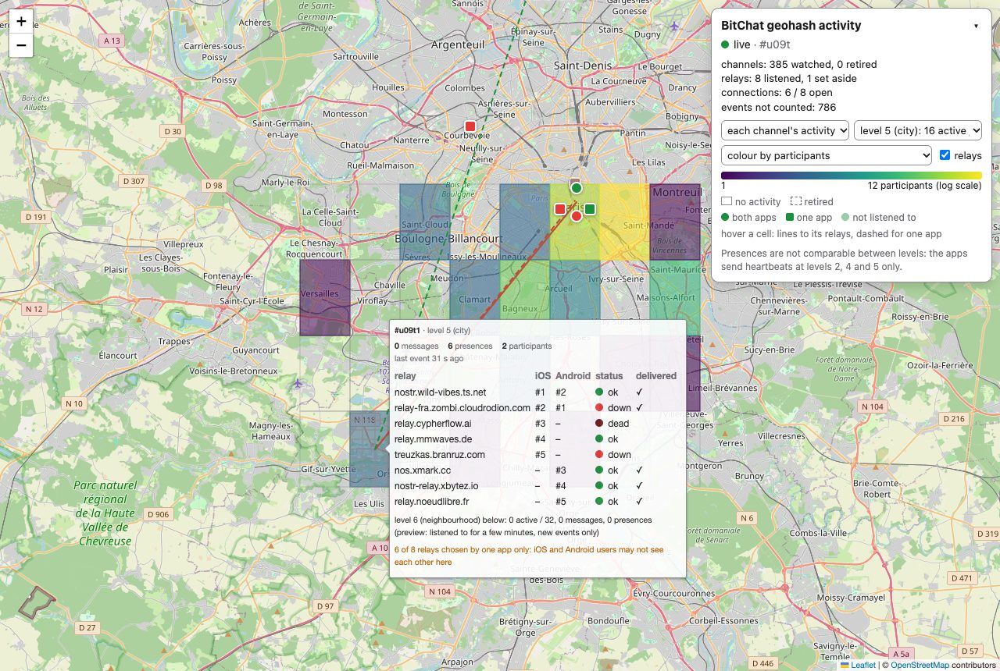

# bitchat-geohash

Live map of BitChat location-channel (geohash) activity.



For each channel inside a geohash, `bitchat-geohash` works out the 5 relays the iOS and
Android apps choose, listens there to location-channel messages and presences (kinds 20000
and 20001), and shows the activity per cell on a live map. It is read-only: it never
publishes and never answers AUTH. The map gets counts only: no pubkey, no nickname, no
message content.

## Install

bitchat-geohash is installed with the other BitChat tools (bitchat-console, and bitchat-launcher
that starts both): the binaries for macOS, Linux and Docker, how to check them, and the
development environment are in
[bitchat-launcher's README](https://github.com/wvmscs/bitchat-launcher#install).
From the sources alone:

```sh
cargo install --git https://github.com/wvmscs/bitchat-geohash
```

## Run

```sh
cargo run --release -- u09 --depth 2 --open
```

The map is served on `http://127.0.0.1:8080/`. Over HTTP/1.1 the browser keeps at most
6 connections per host, and each live tab holds one, so for many tabs use HTTPS (HTTP/2)
with a certificate the browser trusts:

```sh
mkcert -install && mkcert localhost 127.0.0.1 ::1
cargo run --release -- u09 --tls-cert localhost+2.pem --tls-key localhost+2-key.pem --open
```

The area may also be a place or an IP address (feature `geocode`, on by default), looked up
with [geohash-lookup](https://github.com/wvmscs/geohash-lookup): the finest cell that holds
it.

```sh
cargo run --release -- "Rue de Rivoli, Paris" --open     # #u09tv
cargo run --release -- 8.8.8.8 --geoip-db ~/.local/share/bitchat-geohash/dbip-city-lite.mmdb
```

A place typed goes straight to BAN (French addresses) and Nominatim (OpenStreetMap), which
see it with this machine's IP address; IP addresses are looked up in the local DB-IP file,
downloaded at the `--geoip-db` path when missing (about 130 MB). A bare geohash stays a
geohash (`u09t`, or `#u09t`); one word of letters and digits that is not one (`u0a`) is
refused. Build with `--no-default-features --features server` to leave it out.

A public map (`--behind-proxy`, or a non-loopback `--listen`) has no login, so its pages take
geohashes only and show no name: otherwise anyone could send requests to these services from
your machine. `--geocode-public` allows them; put a login in the proxy and respect
[Nominatim's usage policy](https://operations.osmfoundation.org/policies/nominatim/). The area
given on the command line can still be a place.

To serve it on a public name, a TLS proxy in front (Cloudflare Tunnel, NGINX, Caddy) is
enough: `--behind-proxy https://map.example.org`. The map then accepts only what comes
through the proxy in HTTPS, and checks at start that the name leads to it; the configurations
are in [docs/behind-proxy.md](docs/behind-proxy.md).

By default the map shows the relays chosen today by bitchat iOS and Android, each with its list
and rule. `--strategy airhop|a0|a1`, or the selector under the area in the panel, shows the
relays another strategy of
[geohash-relays](https://github.com/wvmscs/geohash-relays/blob/strategies/docs/clients.md)
would choose. In each cell, green or red badges show whether a phone using it would exchange
messages with bitchat iOS and with bitchat Android as released today (under the apps' own
strategy: whether iOS and Android phones exchange). A public map keeps the strategy it was
started with.

On the map:

- Hover a cell for its counts and relays; hovering a while also previews the level below.
- Click a cell to descend one level, go back up, or reinstate a retired cell.
- Type another area in the panel (a geohash, `#u09t`, a place or an IP address) and press
  "Watch" to watch it instead, without restarting; its approximate name shows below the
  field.
- In the panel, choose the level and the scale, show the relays, or show the meshes (the
  sum of the channels inside each one).

Run `bitchat-geohash` with a wrong option to list them all. In the terminal, the `watch`
example shows the same counts without the map:

```sh
cargo run --example watch -- u09 --depth 2
```

## In the browser, without a server

The map also runs entirely in the browser: the same page, with the monitor compiled to
WebAssembly in a worker, its state kept in the browser's database. Build the static site, then
serve its directory at the root of any web server:

```sh
rustup target add wasm32-unknown-unknown
cargo install wasm-bindgen-cli --version 0.2.130   # the version in Cargo.toml
web/build.sh                                       # target/web
python3 -m http.server -d target/web 8000          # then http://localhost:8000/?area=u09t
```

The page's address takes the options of the command line: `?area=u09t&depth=2&strategy=a1`
is `u09t --depth 2 --strategy a1`. What the browser cannot do: no Tor (the relays see the
browser's IP address), no place names, and relay failures are opaque (a relay that refuses is
retried like one that is down). The map runs while its tab is open.

## Documents

- [docs/behind-proxy.md](docs/behind-proxy.md): behind a TLS proxy (Cloudflare Tunnel, NGINX,
  Caddy).
- [AGENTS.md](AGENTS.md): layout, invariants and commands for contributors.
- [CHANGELOG.md](CHANGELOG.md).

## License

GPL-3.0-or-later. Leaflet (BSD-2-Clause), the map tiles of the screenshot (OpenStreetMap) and
the frozen relay lists in `tests/data/` (Unlicense, MIT) keep their own licences. Every file says so with its SPDX tags ([REUSE](https://reuse.software)): a header, or `REUSE.toml`;
the licence texts are in `LICENSES/`.
