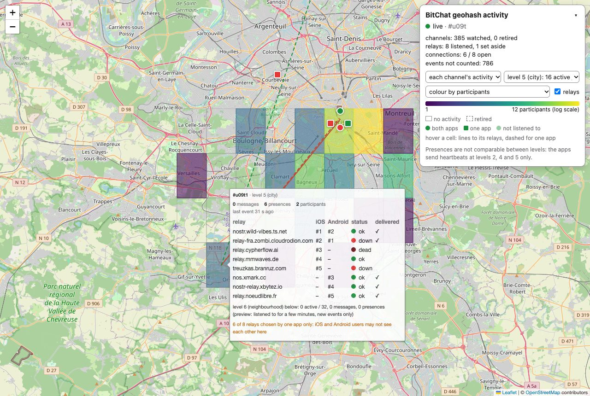

# bitchat-geohash

Live map of BitChat location-channel (geohash) activity.



For each channel inside a geohash, `bitchat-geohash` works out the 5 relays the iOS and
Android apps choose, listens there to location-channel messages and presences (kinds 20000
and 20001), and shows the activity per cell on a live map. It is read-only: it never
publishes and never answers AUTH. The map gets counts only: no pubkey, no nickname, no
message content.

## Run

```sh
cargo run --release -- u09 --depth 2 --open
```

The map is served on `http://127.0.0.1:8080/`. Over HTTP/1.1 the browser keeps at most
6 connections per host, and each live tab holds one, so for many tabs use HTTPS (HTTP/2)
with a certificate the browser trusts:

```sh
mkcert -install && mkcert localhost 127.0.0.1 ::1
cargo run --release -- u09 --tls-cert localhost+2.pem --tls-key localhost+2-key.pem --open
```

On the map:

- Hover a cell for its counts and relays; hovering a while also previews the level below.
- Click a cell to descend one level, go back up, or reinstate a retired cell.
- Type another area in the panel and press "Watch" to watch it instead, without restarting.
- In the panel, choose the level and the scale, show the relays, or show the meshes (the
  sum of the channels inside each one).

Run `bitchat-geohash` with a wrong option to list them all. In the terminal, the `watch`
example shows the same counts without the map:

```sh
cargo run --example watch -- u09 --depth 2
```

## Documents

- [SPECIFICATIONS.md](SPECIFICATIONS.md): what it does and why (in French).
- [PLAN_ET1.md](PLAN_ET1.md), [PLAN_ET2.md](PLAN_ET2.md): progress, decisions and
  measurements (in French).
- [AGENTS.md](AGENTS.md): layout, invariants and commands for contributors.
- [CHANGELOG.md](CHANGELOG.md).

## License

GPL-3.0-or-later. Leaflet (BSD-2-Clause), the map tiles of the screenshot (OpenStreetMap) and
the frozen relay lists in `tests/data/` (Unlicense, MIT) keep their own licences. Every file says so with its SPDX tags ([REUSE](https://reuse.software)): a header, or `REUSE.toml`;
the licence texts are in `LICENSES/`.
